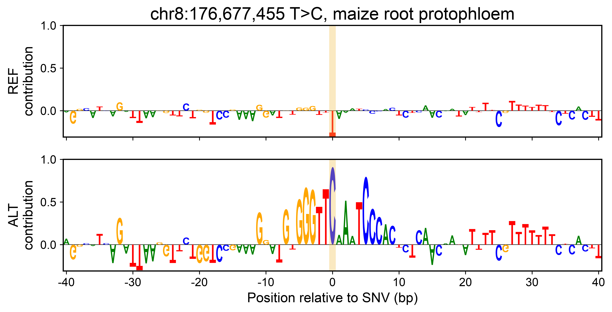

# Case 1: what does a maize caQTL SNV do?

**Question asked (one sentence, no hints):**
> In maize (B73 NAM-5.0), a caQTL SNV at chr8:176,677,455 changes T to C. What does PEAgent predict
> this variant does to chromatin accessibility, in which cell types and in which direction, and what
> sequence feature might explain it? Give an evidence-tiered report.

## What the agent did

1. Loaded the `peagent-agent` and `peagent-variant-effect` skills and planned the analysis.
2. Checked that models and genome were available, and that the SNV lies in an atlas ACR (chr8:176,676,991-176,677,491).
3. Scored REF vs ALT in all 94 cell-type groups, after checking that the genome base is T.
4. Re-read the result table to confirm the numbers.
5. Computed attribution for both alleles in the three most affected cell types and ranked the variant position.
6. Matched the new high-contribution sequence to JASPAR, and searched the PEAgent lexicon for TCP patterns in the same cell type.

The session took 32 turns, 3 minutes and about US$0.9.

## Answer

The C allele raises predicted accessibility in all 94 groups. The gain matters most where the element is already active:

| Cell-type group | REF p | ALT p | Δlogit |
|---|---:|---:|---:|
| root protophloem | 0.134 | 0.436 | +1.73 |
| ear provascular inflorescence strands | 0.079 | 0.188 | +1.03 |
| leaf guard mother cell | 0.011 | 0.042 | +1.35 |

The SNV creates the strongest activating base in the whole 1,344-bp window. In REF, the T is mildly repressive. In ALT, the C becomes rank 1 of 1,344 by contribution and pulls up a new activating segment, `GTGGGTTCAAATCCCAC`.

## Agreement with the paper (Fig. 5F)

| | Paper | Agent |
|---|---|---|
| Direction | ALT more accessible | ALT more accessible in all 94 groups |
| Variant at a high-attribution position in ALT | yes (rank 2/1,344, guard mother cell) | yes (rank 1/1,344) |

The paper used the B73-seedling fine-tuned model. The agent used the released atlas model and reproduced the direction and the high-attribution site.

Evidence tiers: atlas ACR T3; predictions and attribution T4; motif identity T5.
