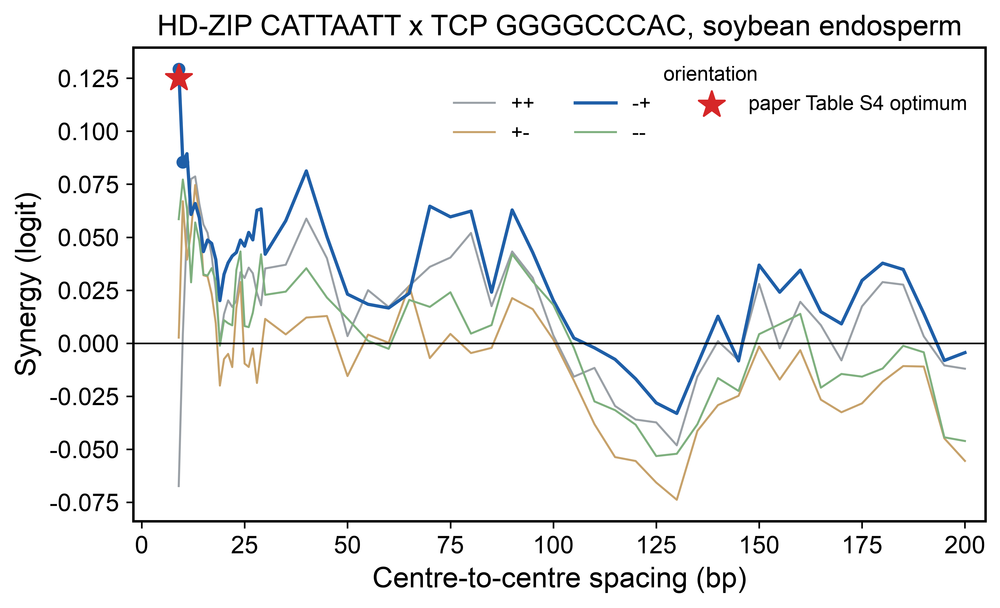

# Case 2: do HD-ZIP and TCP motifs cooperate in soybean endosperm?

**Question asked (in Chinese, no hints):**
> 在大豆种子胚乳（endosperm）细胞中，HD-ZIP 和 TCP 两类转录因子的 motif 之间是否存在协同作用（joint effect
> 大于两者单独效应之和）？如果有，最佳的间距和方向是什么？请用 PEAgent 模型分析并给出带证据分级的报告。

*(In soybean endosperm, do HD-ZIP and TCP motifs act synergistically? If so, at what spacing and orientation?)*

## What the agent did

1. Loaded the `peagent-motif-synergy` skill.
2. Found that the paper already reports these pairs (Table S4), so it framed the work as a re-test.
3. Took the motifs from the paper's own lexicon: HD-ZIP `CATTAATT` and three TCP patterns found in soybean endosperm.
4. Ran the paper's synergy protocol for each pair, pooling all 6 endosperm groups (8,511 cells). The protocol uses 100 GC-matched genomic backgrounds, spacings of 0-200 bp and all four orientations.
5. Sent a literature sub-agent for experimental (T1/T2) evidence and a verifier sub-agent to re-check every number against the run records.

The session took 18 turns, 5 minutes and about US$1.6. It answered in Chinese.

## Answer

Yes. The model predicts hard-syntax synergy: the two motifs must be almost adjacent and in a fixed orientation. Only 2 of 224 arrangements are significant at padj < 0.01.

| Pair (paper ID) | Best orientation | Centre spacing | Synergy, agent | Synergy, paper |
|---|---|---:|---:|---:|
| HD-ZIP x `GGGGCCCAC` (1_15) | `-+` | 9 bp | 0.129 | 0.125 |
| HD-ZIP x `GTGGTCCC` (1_3) | `--` | 10 bp | 0.094 | 0.082 |
| HD-ZIP x `TGGGCC` (1_9) | `--` | 7 bp | 0.071 | 0.065 |

All three optima match the paper's Table S4. For pair 1_9 the agent's padj was 0.014, against 0.004 in the paper. The agent attributed this to correcting over one pair rather than all 36 pairs. The literature search found no published HD-ZIP-TCP interaction, so every claim stays at T4.

